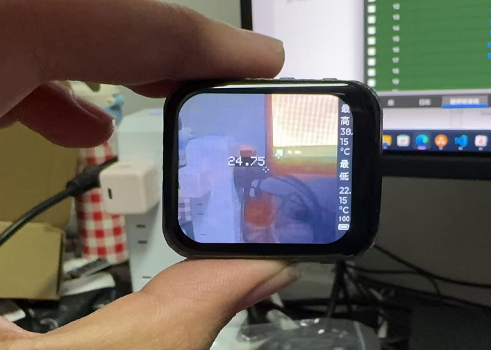

# RP2040 口袋双光热成像仪

用 RP2040、1.69 英寸电容触摸屏和 DVP 摄像头做一台口袋热成像仪。教程从点亮屏幕开始，逐步完成可见光预览、测温、双光融合、双核采集和触摸输入。热探头二选一，支持 MLX90640 和 Heimann HTPA32×32 5.0。



## 硬件

[装配与引脚表](hardware/README.md) · [原理图](hardware/schematic.png) · [Altium 工程](hardware/altium/RP2040DualVision.PrjPcb)

下载整个仓库后打开 `RP2040DualVision.PrjPcb`，工程会按相对路径加载原理图和 PCB。

## 教程

| 章节 | PlatformIO 环境 | 实验 |
| --- | --- | --- |
| [00 硬件装配](hardware/README.md) |  | 准备物料，核对排线和电源 |
| [01 PlatformIO 入门](examples/01_hello_world) | `01_hello_world` | 配置环境、编译烧录及 USB 串口 |
| [02 点亮屏幕](examples/02_screen) | `02_screen` | ST7789 彩条与方向 |
| [03 摄像头](examples/03_camera) | `03_camera` | PicoCamera 捕获 RGB565 并预览 |
| [04 MLX90640 测温](examples/04_thermal_mlx90640) | `04_thermal_mlx90640` | 子页采集、标定和热图 |
| [05 MLX90640 双光融合](examples/05_fusion_mlx90640) | `05_fusion_mlx90640` | 图像配准与透明度 |
| [06 双核](examples/06_multicore) | `06_multicore` | 热帧采集与屏幕渲染并行 |
| [07 Heimann 5.0 测温](examples/07_thermal_heimann) | `07_thermal_heimann` | 32×32 测温、偏置校正与查表 |
| [08 Heimann 5.0 双光融合](examples/08_fusion_heimann) | `08_fusion_heimann` | 把 Heimann 热图叠加到可见光 |
| [09 触摸屏](examples/09_touch_screen) | `09_touch_screen` | 读取触摸坐标并在屏幕上画点 |

## 配置环境、编译和烧录

第一次使用 PlatformIO，从第一课的图文步骤开始，安装 VS Code、Git 和 PlatformIO IDE，打开含 `platformio.ini` 的仓库根目录，再编译并烧录第一个 UF2。 [PlatformIO 环境配置图文教程](examples/01_hello_world/)

已有 PlatformIO Core 时，可在仓库根目录直接编译。首次构建需要联网安装固定版本的 Arduino-Pico 工具链。

```sh
pio run -e 01_hello_world
```

1. 按住接到 QSPI SS 的 BOOTSEL 键，插入 USB 数据线或复位。等待系统挂载 `RPI-RP2`。
2. 把 `.pio/build/01_hello_world/firmware.uf2` 复制到该盘。复制结束后，开发板会自动重启。
3. 运行 `pio device monitor -b 115200`。如果有多个串口，可先运行 `pio device list`，再用 `-p` 指定设备。
4. 编译其他实验时，替换 `-e` 后的环境名。对应 UF2 位于同名构建目录。

RP2040 的单帧可见光缓冲为 160×120 RGB565，占 38,400 字节。各实验用一行缓冲把画面送到 ST7789。旋转、缩放和混色在读像素时执行。

本工程使用 PlatformIO 的 Arduino-Pico 核心。DVP 摄像头由 Arduino-Pico 的 PicoCamera 管理，使用 PIO 和 DMA 采集。 [Arduino-Pico 的 PlatformIO 指南](https://arduino-pico.readthedocs.io/en/latest/platformio.html) · [PicoCamera API](https://arduino-pico.readthedocs.io/en/latest/camera.html)

教程编排参考 ESP32 双光融合项目。仓库许可和第三方来源见下列文件。 [ESP32 教学仓](https://github.com/umeiko/ESP32_Dual_Vision_Thermal) · [许可证](LICENSE) · [第三方来源](NOTICE)
