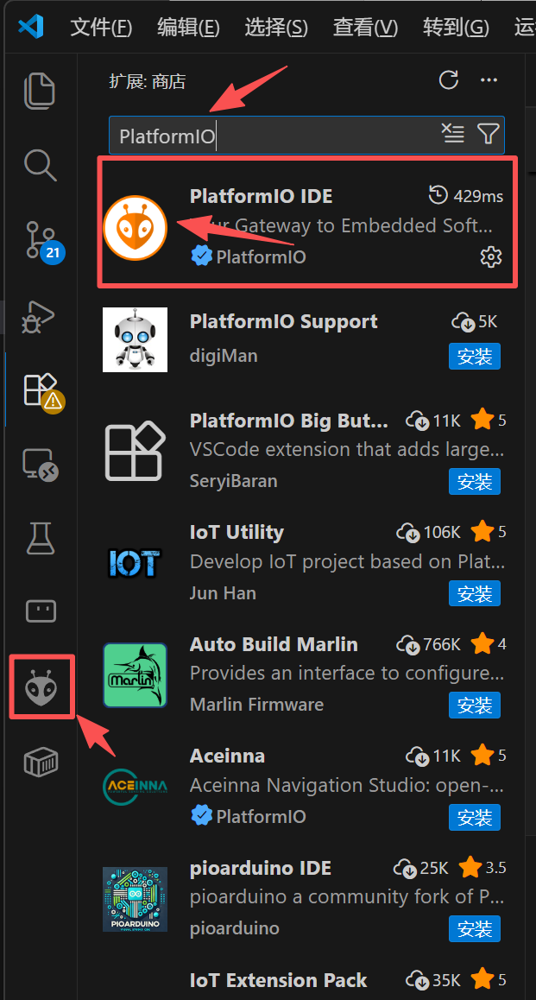
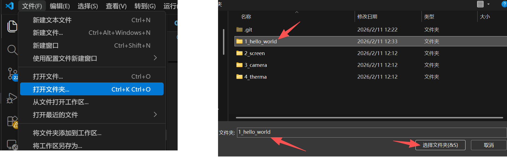
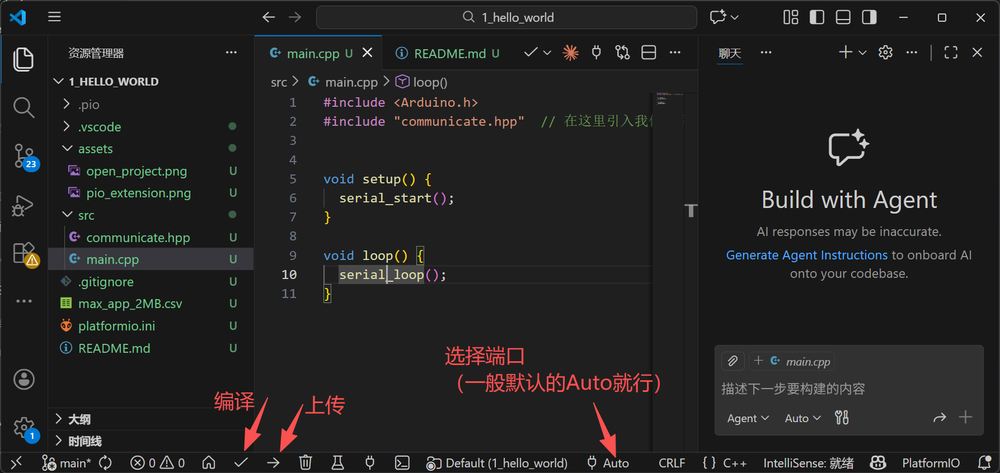
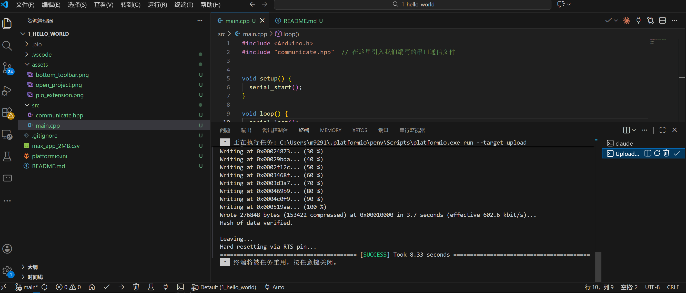
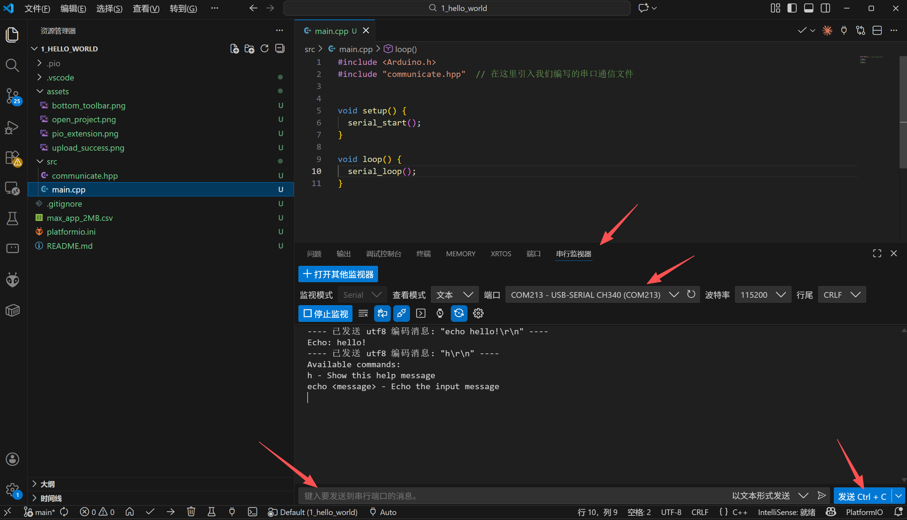

# 01 从零配置 PlatformIO，运行第一个 RP2040 实验

这一课用 VS Code 装好 PlatformIO，编译一份 RP2040 固件，再通过 USB 串口读取按键状态和电池电压。安装入口和按钮位置沿用参考课程的截图。具体目录、烧录步骤和串口输出以本页的 RP2040 说明为准。 [ESP32 教学仓第一课](https://github.com/umeiko/ESP32_Dual_Vision_Thermal/tree/fe181c71480a09a115e08885b692dc694c452fd2/1_hello_world)

## 1. 安装 VS Code、Git 和 PlatformIO IDE

1. 安装 [Visual Studio Code](https://code.visualstudio.com/) 和 [Git](https://git-scm.com/downloads)。PlatformIO 首次构建时会用 Git 获取本项目的 RP2040 平台包。安装后可在终端运行 `git --version` 检查。
2. 打开 VS Code，点左侧由四个方块组成的 **扩展（Extensions）**。在搜索框输入 `PlatformIO IDE`，找到发布者为 **PlatformIO** 的扩展，点击 **安装（Install）**。
3. 等待扩展完成初始化。左侧活动栏出现 PlatformIO 图标后，点开即可看到项目任务。扩展自带 PlatformIO Core，可直接使用。 [PlatformIO 官方安装说明](https://docs.platformio.org/en/stable/integration/ide/vscode.html#installation)



## 2. 打开项目根目录

在 [仓库首页](https://github.com/umeiko/rp2040-duo-vision-thermal) 点 **Code → Download ZIP** 并解压。下面的命令也可以下载仓库。

```sh
git clone https://github.com/umeiko/rp2040-duo-vision-thermal.git
```

在 VS Code 里选择 **文件 → 打开文件夹（Open Folder）**，打开包含 `platformio.ini` 的 **`rp2040-duo-vision-thermal` 根目录**。项目配置和各课的编译环境会自动加载。



可以先查看这三个文件。

| 路径 | 用途 |
| --- | --- |
| [`platformio.ini`](../../platformio.ini) | 集中定义工具链、开发板和各章编译环境 |
| [`examples/01_hello_world/main.cpp`](main.cpp) | 第一课入口，包含 Arduino 的 `setup()` 和 `loop()` |
| [`include/board_pins.hpp`](../../include/board_pins.hpp) | 这块板的按键、电池 ADC、屏幕、相机和探头引脚 |

### 读懂 `platformio.ini`

| 配置 | 在本仓库里的作用 |
| --- | --- |
| `board = pico` | 使用 RP2040 的 Pico 构建目标 |
| `framework = arduino` 和 `board_build.core = earlephilhower` | 使用 Earle Philhower 的 Arduino-Pico 核心 |
| `platform` 和 `platform_packages` | 固定 RP2040 平台的提交和 Arduino-Pico 6.4.0，首次构建时自动下载 |
| `[env:01_hello_world]` 和 `build_src_filter` | 第一课只构建自己的 `main.cpp`；其他课程各有对应环境 |
| `lib_deps` | 为使用屏幕的环境安装显示库 |
| `monitor_speed = 115200` | 串口监视器的默认波特率 |

首次构建需要访问 GitHub 和 PlatformIO Registry。依赖下载完成后，PlatformIO 会复用本机缓存。

## 3. 认识工具栏并编译

VS Code 底部的 PlatformIO 工具栏收录了这几个常用按钮。

- **✓ Build** 编译当前环境并生成固件。
- **→ Upload** 执行当前环境的上传任务。下方给出了本板的 UF2 烧录步骤。
- **插头图标 Serial Monitor** 打开串口监视器，读取板子的输出。



点左侧 PlatformIO 图标，展开 **Project Tasks → 01_hello_world → General → Build**。终端显示 `SUCCESS` 后，固件在 `.pio/build/01_hello_world/firmware.uf2`。如果文件管理器隐藏了 `.pio`，可从 VS Code 终端访问这个相对路径。

使用命令行时，可从 VS Code 底部工具栏打开 **PlatformIO Core CLI**。也可以在已安装 PlatformIO Core 的终端中进入项目根目录，执行下面两条命令。

```sh
pio --version
pio run -e 01_hello_world
```

## 4. 用 BOOTSEL 烧录 UF2

1. 让板子进入 BOOTSEL 模式。给板子断电后，按住接到 QSPI SS 的 **BOOTSEL（KEY2）**，再插入 USB 数据线。已供电时，可按住 BOOTSEL 并复位。看到 `RPI-RP2` 盘后松开按键。
2. 把 `.pio/build/01_hello_world/firmware.uf2` 复制到 `RPI-RP2`。复制完成后，盘会自动退出，板子重启。
3. 等待系统重新识别 RP2040 的 USB 串口。 [Arduino-Pico 的 BOOTSEL 说明](https://arduino-pico.readthedocs.io/en/stable/install.html#uploading-sketches)

<details>
<summary>查看参考仓中的 PlatformIO 上传终端</summary>

下图来自 ESP32 课程，展示上传任务的日志和 `SUCCESS` 位置。RP2040 复制 UF2 后，可通过下一节的串口输出确认固件已经运行。



</details>

## 5. 打开串口监视器

点工具栏的 **Serial Monitor**，或在 **Project Tasks → 01_hello_world → General → Monitor** 打开监视器。串口波特率为 **115200**。如果电脑连了多块板子，可先用 `pio device list` 找到 RP2040 对应的端口，然后用 `pio device monitor -p <端口> -b 115200` 指定它。



第一课每 500 ms 打印一行。按住 **用户按键 KEY（KEY1）** 时，`KEY` 会从 `released` 变为 `pressed`。下面是电池电压为 4.08 V 时的输出示例。

```text
RP2040 ready | KEY=released | VBAT=4.08 V
RP2040 ready | KEY=pressed | VBAT=4.08 V
```

源码里，`setup()` 初始化 USB 串口、按键和 12 位 ADC。 `loop()` 读取 GPIO10 与 GPIO28，把 ADC 值按 30 kΩ、68 kΩ 的分压比换算为电池电压。 [第一课源码](main.cpp)

## 常见问题

| 现象 | 检查方法 |
| --- | --- |
| 左侧看不到项目任务 | 确认 PlatformIO IDE 已初始化，当前打开的文件夹能直接看到 `platformio.ini` |
| 初次安装依赖失败 | 先运行 `git --version`，再检查能否访问 GitHub 和 PlatformIO Registry，恢复连接后重新 Build |
| 找不到 `RPI-RP2` | 换一根支持数据传输的 USB 线，关闭串口监视器，再按住 BOOTSEL（KEY2）上电或复位 |
| 串口没输出 | 确认固件写入后已经重启，重新运行 `pio device list`，选择新出现的 USB 串口 |
| 串口被其他程序占用 | 关闭其他串口监视器，再打开 PlatformIO Monitor |

完成本课后，仍然打开同一个根目录，在 Project Tasks 中选择 `02_screen`，或运行 `pio run -e 02_screen`。各章生成的 UF2 会放在各自的构建目录。 [下一课 · 点亮 ST7789](../02_screen/)
