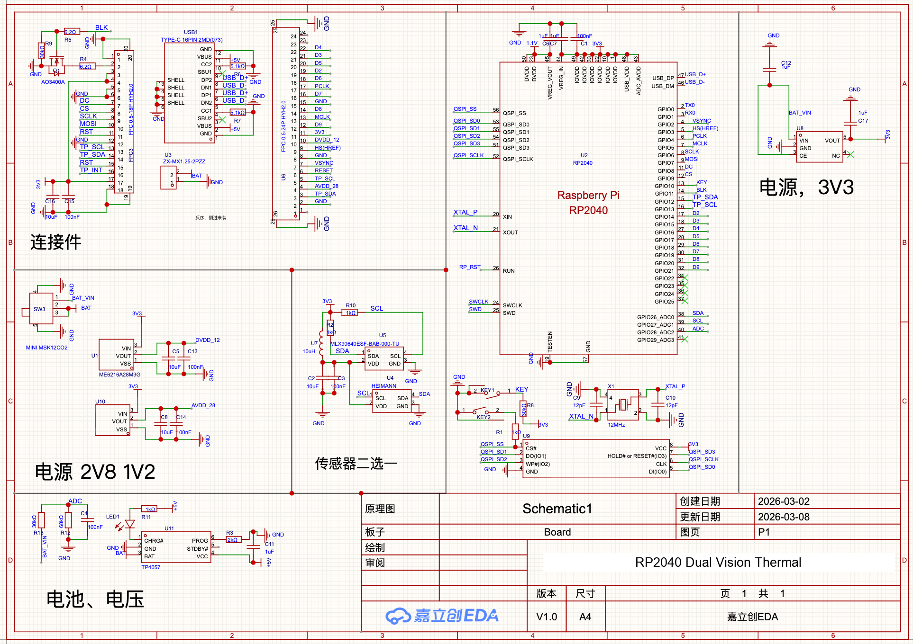
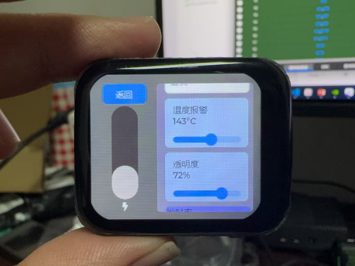

# 00 硬件装配

- 主控为 RP2040，USB-C 用于供电、UF2 烧录和串口。
- 屏幕为 1.69 英寸 240×280 ST7789 电容触摸屏，实验使用 280×240 横屏。
- 可见光使用与板上 FPC 和供电匹配的 DVP 模组，教程按 OV7670 装机方向显示。
- MLX90640 和 Heimann HTPA32×32 5.0 共用热探头接口，择一安装。MLX90640 实验要求 I²C 地址为 `0x33`。
- 电池接口与开关按原理图接线。检查电池极性后再接通。屏幕与摄像头的 FPC 都应在断电时插拔。

## 设计文件

将 [Altium 工程](altium/RP2040DualVision.PrjPcb)、[原理图文档](altium/Board/Schematic1/P1.schdoc) 和 [PCB 文档](altium/Board/PCB1.pcbdoc) 按仓库路径保留在同一目录树。可直接打开 [原理图预览](schematic.png) 核对接线。

## GPIO

| 用途 | RP2040 GPIO |
| --- | --- |
| DVP VSYNC / HREF / PCLK / XCLK | 2 / 3 / 4 / 5 |
| DVP D2–D9（最低位到最高位） | 14–21 |
| LCD SCK / MOSI / DC / CS / BLK | 6 / 7 / 8 / 9 / 11 |
| 用户按键 KEY（低电平有效） | 10 |
| 触摸与相机 SCCB，I²C0 SDA / SCL | 12 / 13 |
| 热探头 I²C1 SDA / SCL | 26 / 27 |
| 电池电压 ADC | 28 |

LCD RST、摄像头 RESET 在 FPC 上有标注。示例的 GPIO 定义为 `-1`，驱动通过模块的上电复位和软件初始化启动。摄像头的 2.8 V、1.2 V 供电对应 FPC 的 AVDD、DVDD。 [GPIO 定义](../include/board_pins.hpp)

## 上电检查

1. 检查 3.3 V、摄像头电源和各座子标注，按 PCB 标注确认屏幕与相机排线的触点方向。
2. 先烧录 [串口实验](../examples/01_hello_world)，确认 USB 枚举和普通 KEY 按键。
3. 按顺序运行屏幕、相机、对应探头的热图实验，再进入双光融合。
4. 换探头后编译对应环境。使用触摸实验时可从画点的位置判断屏幕坐标变换。

